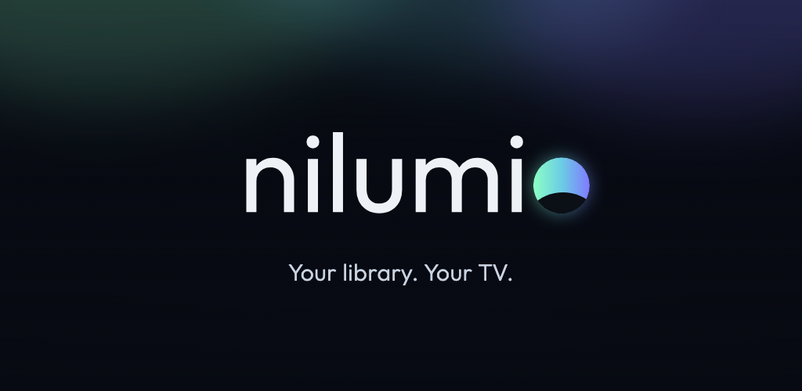
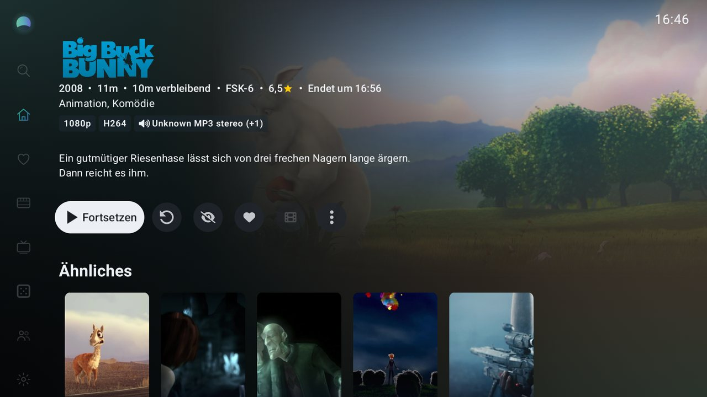
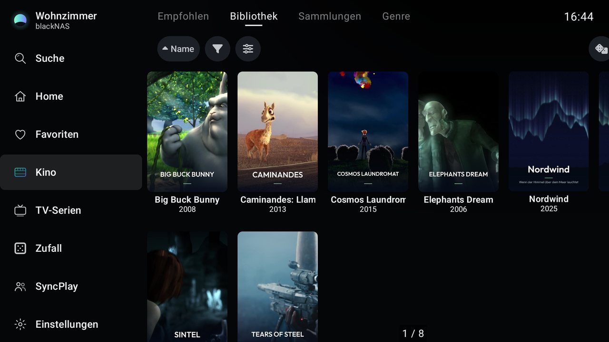
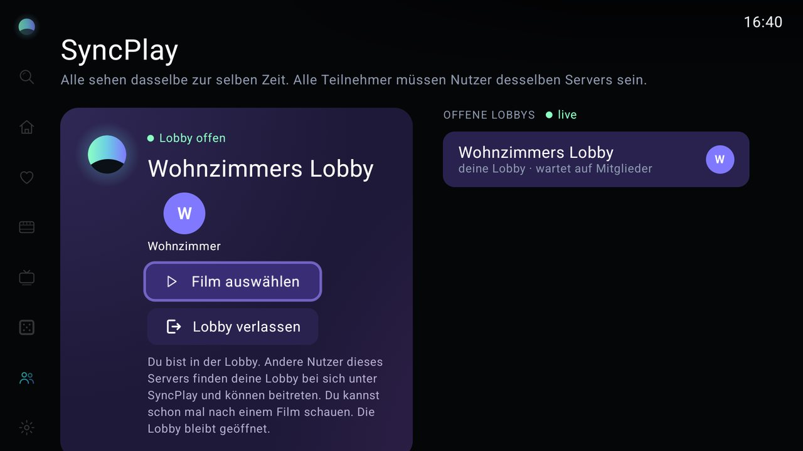
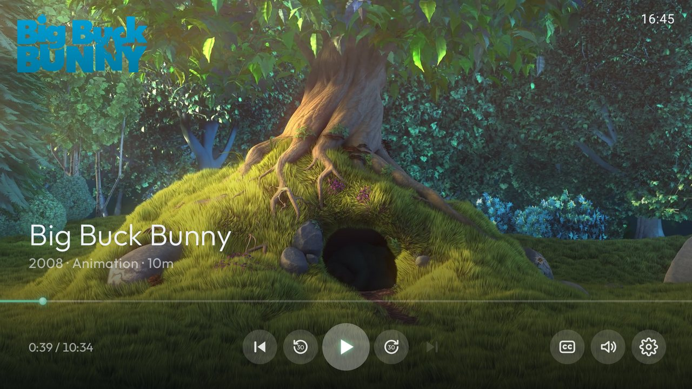

<!-- nilumio: start of fork section. Everything below the end marker is the original Wholphin README. -->
# nilumio for Android TV

> **Kurz auf Deutsch:** nilumio ist eine Android-TV-App für deinen eigenen Jellyfin-Server. Sie ist ein Fork von Wholphin und steht wie Wholphin unter der GPL-2.0. Neu sind unter anderem eigenes Design, Start-Intro, Startseiten-Reihen nach Genre, SyncPlay (gemeinsam schauen). Alle Änderungen gegenüber Wholphin stehen in [NILUMIO_CHANGES.md](NILUMIO_CHANGES.md). Kontakt: webmaster@nilumio.com

**nilumio** is an Android TV app for your own [Jellyfin](https://jellyfin.org) media server: a calm, dark interface with large artwork, built for the remote control. It is a fork of [Wholphin](https://github.com/damontecres/Wholphin) by damontecres and keeps Wholphin's playback engines (ExoPlayer and MPV), home screen customisation and settings.

What nilumio adds on top of Wholphin:

- its own name, logo, colours and typography, and a short start-up intro
- home screen rows by genre
- *SyncPlay*: synchronised playback with Jellyfin SyncPlay groups
- wording fixes in the German and other translations

nilumio is not an official Jellyfin or Wholphin product. Website: [nilumio.com](https://nilumio.com)

## Screenshots

<p align="center">
  
</p>

| Film page | Menu |
|---|---|
|  |  |
| **SyncPlay** | **Player** |
|  |  |

<sub>Screenshots show free Blender open movies (“Big Buck Bunny”, “Sintel”, “Tears of Steel”, “Elephants Dream”, “Cosmos Laundromat”, “Caminandes”; Blender Foundation / Blender Studio, CC BY, <a href="https://studio.blender.org/films/">studio.blender.org</a>) and our own demo titles.</sub>

## Origin and licence

- Based on Wholphin, `main` at commit [`551501f`](https://github.com/damontecres/Wholphin/commit/551501fa759d95f7eb601455149ccdf2e8602192) (October 2026). The upstream repository is configured as the `upstream` remote.
- Licence: [GNU General Public License v2.0](LICENSE), like Wholphin. Every file that nilumio added or modified, with the date of the change, is listed in [NILUMIO_CHANGES.md](NILUMIO_CHANGES.md).
- Code taken or ported from other projects (jellyfin-web, Wholphin-Enhanced, fonts) is listed in [THIRD_PARTY_NOTICES.md](THIRD_PARTY_NOTICES.md).
- The GPL covers the code, it is not a trademark licence. If you publish a build of your own, please give it your own name and logo.
- An overview of how much of this repository is nilumio's own work is in [docs/OWN_CODE.md](docs/OWN_CODE.md).

## Building

Requirements: a recent Android Studio or JDK 17+ with the Android SDK (`local.properties` with `sdk.dir`, not committed).

```sh
./gradlew assembleDebug          # debug build, installs side by side with a release build
./gradlew testDebugUnitTest      # unit tests
```

Release builds are signed with a key outside the repository: if `~/.config/nordlicht/keystore.properties` exists (keys `storeFile`, `storePassword`, `keyAlias`, `keyPassword`), `./gradlew assembleRelease` or `bundleRelease` uses it. Without that file you get an unsigned release build. Never commit keystores or passwords; `.gitignore` excludes them.

Optional native extensions (MPV, FFmpeg and AV1 decoders) are described in Wholphin's [DEVELOPMENT.md](DEVELOPMENT.md).

## Contributing

Small, focused pull requests are welcome. Please read [CONTRIBUTING.md](CONTRIBUTING.md) first: bugs that also exist in Wholphin should go to Wholphin first, and nilumio keeps its own code separate from Wholphin's so upstream updates stay easy ([docs/UPSTREAM.md](docs/UPSTREAM.md)).

## Contact

- General questions and feedback: webmaster@nilumio.com
- Security issues: see [SECURITY.md](SECURITY.md)

## Wholphin

nilumio builds on [Wholphin](https://github.com/damontecres/Wholphin) by damontecres, an open-source Android TV client for Jellyfin. Its full feature list, documentation and history are in the [Wholphin README](https://github.com/damontecres/Wholphin#readme). Thank you to everyone who works on Wholphin.
